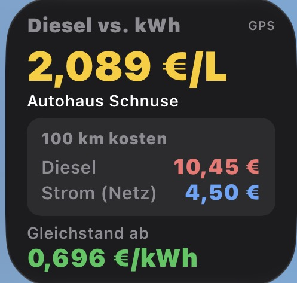

# Diesel vs. kWh — iOS Widget for Scriptable

A small home screen widget for iPhone that answers one question at a glance:

**"Is it cheaper to drive my diesel car or charge my electric car at home?"**

The widget finds the nearest diesel station with the [Tankerkönig](https://creativecommons.tankerkoenig.de/) price API, shows its current price, and calculates what 100 km cost by diesel versus grid electricity. It also shows the **break-even electricity price**: the price per kWh at which charging costs the same as diesel.

<p align="center">
  
</p>

> **Note:** This project was developed with the help of AI (Claude by Anthropic). The idea, the requirements, and the testing on my own iPhone are mine; the code was written in collaboration with an AI assistant.

## Features

- Automatic location (GPS), with a cached last location and a fallback if GPS is unavailable
- Nearest diesel price within a configurable radius (default 8 km), sorted by price
- Cost comparison for 100 km: diesel vs. grid electricity
- Break-even price per kWh, calculated from your vehicle's consumption
- Dark design that fits well on the iOS home screen

## Requirements

- iPhone with iOS 15 or newer
- [Scriptable](https://apps.apple.com/app/scriptable/id1405459188) (free app from the App Store)
- A free Tankerkönig API key (see below)

## Setup

1. **Get an API key**
   Register for free at <https://creativecommons.tankerkoenig.de/> and copy your API key.

2. **Add the script to Scriptable**
   - Open Scriptable and tap **+** to create a new script.
   - Paste the contents of [`diesel-vs-kwh.js`](diesel-vs-kwh.js).
   - Rename the script to `Diesel vs kWh` (optional, but it makes it easy to find).

3. **Insert your API key**
   Replace the placeholder at the top of the script:

   ```javascript
   const TANKERKOENIG_KEY = "YOUR_TANKERKOENIG_API_KEY";
   ```

   Keep your key private. Do not commit or share a version of the script that contains it.

4. **Adjust your vehicle settings** (optional)

   ```javascript
   const DIESEL_VERBRAUCH = 5;    // liters per 100 km (diesel car)
   const AVG_VERBRAUCH_KWH = 15;  // kWh per 100 km (electric car)
   const PAID_RATE = 0.30;        // your electricity price in €/kWh
   const RADIUS_KM = 8;           // search radius for gas stations
   ```

5. **Add the widget to your home screen**
   - Long-press your home screen and tap **+**.
   - Search for **Scriptable**, choose a **small** widget, and place it.
   - Long-press the widget → **Edit Widget** → choose `Diesel vs kWh` as the script.

6. Allow Scriptable to access your **location** when prompted. Choose *While Using* or *Always*; the widget falls back to the last known location if permission is missing.

## How the calculation works

| Value | Formula |
|---|---|
| Diesel cost per 100 km | `DIESEL_VERBRAUCH × diesel price` |
| Grid electricity cost per 100 km | `AVG_VERBRAUCH_KWH × PAID_RATE` |
| Break-even electricity price | `diesel cost per 100 km ÷ AVG_VERBRAUCH_KWH` |

If your home electricity costs less than the break-even price, the EV is cheaper per kilometre than the diesel car at that moment.

## Notes

- The UI texts are in German, since the widget was built for use in Germany. Feel free to translate the strings in `createWidget()`.
- Fuel prices change several times per day, so the widget refreshes automatically based on iOS's widget refresh schedule.
- The Tankerkönig API is a free public service. Please use it responsibly.

## Privacy

The script stores the last known location and the last fetched price **only on your device** (in Scriptable's documents folder). Location is sent to the Tankerkönig API solely to find nearby stations.

## License

This project is licensed under the [MIT License](LICENSE).
